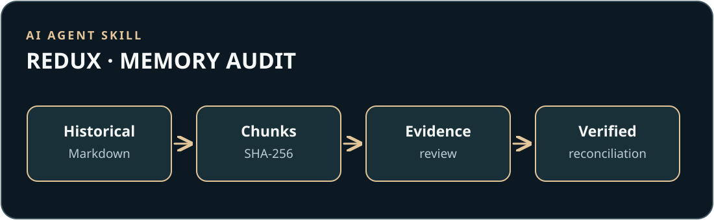

# REDUX — Memory Audit Skill

**An AI agent skill for historical memory recovery, provenance tracking and reconciliation.**

REDUX helps inspect large Markdown conversation exports, handoffs and historical documentation against the current records in a user-controlled workspace. It complements [Avatar](https://github.com/Siddhartha-92/_skill_avatar-persistent-memory): Avatar manages agent identity and ongoing continuity; REDUX audits what history may have lost.

## Workflow at a glance



The image illustrates the intended audit procedure, not automatic semantic verification. The included Python utility validates deterministic source coverage and recorded states; an agent still needs to review evidence and verify any authorized downstream write.

## What it does

- Splits a source Markdown file into **byte-preserving, line-numbered chunks**.
- Records **SHA-256 provenance** and tracks coverage in a manifest.
- Guides review of every chunk, deduplication of events and comparison against current Notion records.
- Distinguishes supported facts, user reports, hypotheses and unresolved contradictions.
- Requires read-back verification before marking a Notion update as verified.
- Reports **PARTIAL**, **COMPLETE** or **BLOCKED** without treating chunking as semantic auditing.

## Included files

- [`SKILL.md`](SKILL.md) — agent workflow, scope and commands.
- [`references/reconciliation-protocol.md`](references/reconciliation-protocol.md) — evidence handling and reconciliation policy.
- [`references/field-report.md`](references/field-report.md) — report template.
- [`scripts/redux_ledger.py`](scripts/redux_ledger.py) — local CLI for manifest preparation and verification.
- [`tests/test_redux_ledger.py`](tests/test_redux_ledger.py) — bundled unit tests.

## Requirements

Python 3 (standard library for the included CLI); access to the original Markdown source files; a durable location for ledgers/manifests; and a connected, authorized Notion workspace for reconciliation against live records. Avatar is recommended for identity/handoff management.

## Quick start

```bash
python scripts/redux_ledger.py --help
python scripts/redux_ledger.py prepare SOURCE.md --out REDUX_WORK/source-key
```

Then review all chunks with an agent following `SKILL.md`, reconcile against real records, and run:

```bash
python scripts/redux_ledger.py verify REDUX_WORK/source-key/manifest.json
python -m unittest discover -s tests -v
```

The CLI verifies **file integrity and recorded processing status**, not semantic correctness of an agent's conclusions.

## Commands

```text
@redux /new @ MY_PROJECT
@redux /ingest SOURCE.md
@redux /audit
@redux /status
@redux /resume
@redux /handoff
```

These are agent text triggers; host-specific native commands are not guaranteed.

## Privacy and limitations

Review sources before ingestion: historical exports may contain personal data, client records or credentials. Do not publish source archives, intermediate ledgers or private Notion links. Reconciliation writes require project authorization and deduplication. REDUX does not replace the responsible project agent or Avatar lifecycle.

## Status

Public adaptation of **REDUX v1.0**. The code and tests are included from the installed skill; publication does **not** assert that the full workflow was validated in a fresh external workspace.

## License

MIT — see [LICENSE](LICENSE).
